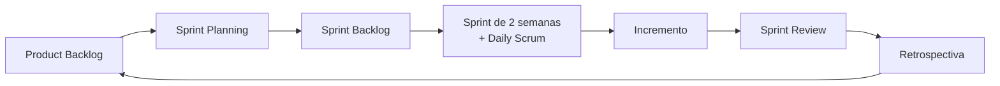

# 🚀 Projeto Engenharia de Software

### Sistema de Gestão de Serviços · KG Refrigeração

**Projeto acadêmico da disciplina de Engenharia de Software (BSI · UFRN/CERES), desenvolvido com o framework Scrum.**

[Visão do Produto](#-visão-do-produto) •
[Equipe](#-equipe-scrum) •
[Como trabalhamos](#-como-trabalhamos) •
[Sprints](#-sprints) •
[Documentação](#-documentação)

---

## 🎯 Sobre o projeto

O objetivo principal deste projeto é **praticar, de forma real e acompanhável, os conceitos do Scrum**: papéis, eventos, artefatos e compromissos. Todo o trabalho da equipe fica registrado aqui no GitHub, para que a professora possa acompanhar a evolução de cada Sprint.

| Conceito do Scrum | Onde está no GitHub |
|---|---|
| **Product Backlog** | [Issues](../../issues) com a label `backlog` |
| **Sprint Backlog** | [Board do Projeto](../../projects) filtrado pela Sprint atual |
| **Sprints** | [Milestones](../../milestones) (uma por Sprint) |
| **Incremento** | Pull Requests aceitos na branch `main` + [Releases](../../releases) |
| **Eventos (Planning, Daily, Review, Retro)** | Atas em [`docs/atas`](docs/atas) e relatórios em [`docs/sprints`](docs/sprints) |
| **Definition of Done** | [`docs/definition-of-done.md`](docs/definition-of-done.md) |

## 💡 Visão do Produto

A **KG Refrigeração** (Caicó/RN) controla seus clientes e serviços com anotações e WhatsApp, o que deixa as informações espalhadas e difíceis de consultar.

Este projeto entrega um **sistema web com o CRUD de Clientes**: cadastrar, listar, consultar por CPF, atualizar e inativar clientes, de forma incremental a cada Sprint.

📄 Visão completa: [`docs/visao-do-produto.md`](docs/visao-do-produto.md) · 🗂️ Backlog: [`docs/backlog-inicial.md`](docs/backlog-inicial.md)

## 👥 Equipe Scrum

| Papel | Integrante | GitHub |
|---|---|---|
| **Product Owner** | _a definir_ | |
| **Scrum Master** | _a definir_ | |
| **Developers** | Franciedson Lucas Linhares da Silva | [@FranciedsonLLS](https://github.com/FranciedsonLLS) |
| | Juan Vyctor Silva Garcia de Oliveira | |
| | Leonardo Breno da Silva Santos | |
| | Nikcael Gidalte Lopes da Silva | |
| | Vinícius Linhares Queiroz | |

> Os papéis de PO e Scrum Master serão definidos na Sprint 0 (um integrante acumula o papel com o de Developer).

**Professora / Stakeholder:** _a definir_

Responsabilidades de cada papel: [`docs/papeis.md`](docs/papeis.md).

## 🔄 Como trabalhamos

- **Duração da Sprint:** 2 semanas
- **Fluxo do board:** `📥 Backlog` → `📋 Sprint Backlog` → `🔨 Em andamento` → `👀 Em revisão` → `✅ Concluído`
- **Estimativa:** Story Points (sequência de Fibonacci: 1, 2, 3, 5, 8, 13)
- **Fluxo de código:** uma branch por issue → Pull Request → revisão de pelo menos 1 colega → merge na `main`

Detalhes em [`docs/eventos-scrum.md`](docs/eventos-scrum.md) e [`CONTRIBUTING.md`](CONTRIBUTING.md).

## 📅 Sprints

| Sprint | Período | Meta da Sprint | Status |
|---|---|---|---|
| Sprint 0 | _a definir_ | Formar a equipe, definir o produto e o backlog inicial | 🟡 Em andamento |
| Sprint 1 | _a definir_ | Cadastrar, listar e consultar clientes | ⚪ Planejada |
| Sprint 2 | _a definir_ | Atualizar e inativar clientes, interface responsiva | ⚪ Planejada |
| Sprint 3 | _a definir_ | Testes, integridade dos dados e entrega da v1.0 | ⚪ Planejada |

## 📚 Documentação

- [Visão do Produto](docs/visao-do-produto.md)
- [Product Backlog inicial](docs/backlog-inicial.md)
- [Papéis do Scrum](docs/papeis.md)
- [Eventos do Scrum](docs/eventos-scrum.md)
- [Definition of Ready](docs/definition-of-ready.md)
- [Definition of Done](docs/definition-of-done.md)
- [Relatórios de Sprint](docs/sprints)
- [Atas de reuniões](docs/atas)
- [Guia de contribuição](CONTRIBUTING.md)

---

Disciplina de Engenharia de Software

