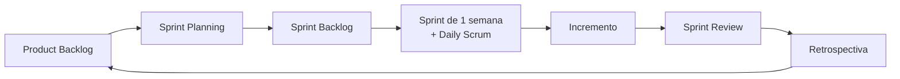

<div align="center">

# 🚀 Projeto Engenharia de Software

### Sistema de Gestão de Serviços · KG Refrigeração

**Projeto acadêmico da disciplina de Engenharia de Software (BSI · UFRN/CERES), desenvolvido com o framework Scrum.**


[Visão do Produto](#-visão-do-produto) •
[Tecnologias](#-tecnologias) •
[Equipe](#-equipe-scrum) •
[Como trabalhamos](#-como-trabalhamos) •
[Sprints](#-sprints) •
[Documentação](#-documentação)

</div>

---

## 🎯 Sobre o projeto

O objetivo principal deste projeto é **praticar, de forma real e acompanhável, os conceitos do Scrum**: papéis, eventos, artefatos e compromissos. Todo o trabalho da equipe fica registrado aqui no GitHub, para que a professora possa acompanhar a evolução de cada Sprint.

| Conceito do Scrum | Onde está no GitHub |
|---|---|
| **Product Backlog** | [Issues](../../issues) com a label `backlog` |
| **Sprint Backlog** | [Board do Projeto](../../projects) filtrado pela Sprint atual |
| **Sprints** | [Milestones](../../milestones) (uma por Sprint) |
| **Incremento** | Pull Requests aceitos na branch `main` + [Releases](../../releases) |
| **Eventos (Planning, Daily, Review, Retro)** | Atas em [`docs/atas`](docs/atas) e relatórios em [`docs/sprints`](docs/sprints) |
| **Definition of Done** | [`docs/definition-of-done.md`](docs/definition-of-done.md) |

## 💡 Visão do Produto

A **KG Refrigeração** (Caicó/RN) controla seus clientes e serviços com anotações e WhatsApp, o que deixa as informações espalhadas e difíceis de consultar.

Este projeto entrega um **sistema web com o CRUD de Clientes**: cadastrar, listar, consultar por CPF, atualizar e inativar clientes, de forma incremental a cada Sprint.

📄 [Documento de Visão](docs/doc-visao.md) · 🧩 [Documento de Modelos](docs/doc-modelos.md) · 🗂️ [Product Backlog](docs/backlog-do-produto.md)

## 🧰 Tecnologias

| Camada | Tecnologia |
|---|---|
| Framework | [Next.js](https://nextjs.org/) (React) |
| Linguagem | JavaScript / TypeScript |
| Persistência | Arquivo JSON local, acessado por uma **camada de repositório** |
| Diagramas | Mermaid |
| Gestão Scrum | GitHub Issues, Milestones e Projects |

> 🗄️ **Banco de dados:** não faz parte deste projeto; será integrado em outra disciplina. Por isso o acesso aos dados fica isolado em um repositório (`ClienteRepository`): hoje ele grava em JSON, e depois basta trocar a implementação por uma de banco, sem mudar telas nem regras de negócio. O modelo de dados já está pronto em [`docs/doc-modelos.md`](docs/doc-modelos.md).

### ▶️ Como executar


**Pré-requisitos:**
- Node.js instalado.
- npm instalado.

**1. Instale as dependências:**

```bash
npm install
```

**2. Inicie o servidor de desenvolvimento:**

```bash
npm run dev
```

**3. Acesse o sistema no navegador:**

http://localhost:3000

**Outros comandos úteis:**

```bash
npm run lint
npm run build
```

- `npm run lint`: verifica problemas no código.
- `npm run build`: gera a versão de produção.

**Persistência:** os dados dos clientes são armazenados localmente em `data/clientes.json`.


## 👥 Equipe Scrum

| Papel | Integrante | GitHub |
|---|---|---|
| **Product Owner** | Juan Vyctor Silva Garcia de Oliveira | [@Juan-Vyctor](https://github.com/Juan-Vyctor) |
| **Scrum Master** | Franciedson Lucas Linhares da Silva | [@FranciedsonLLS](https://github.com/FranciedsonLLS) |
| **Developers** | Leonardo Breno da Silva Santos | [@leonardobreno](https://github.com/leonardobreno) |
| | Nikcael Gidalte Lopes da Silva | [@nikcaellp](https://github.com/nikcaellp) |

> PO e Scrum Master também podem pegar tarefas de desenvolvimento quando necessário.

**Professora / Cliente:** Profª Karliane Medeiros Ovidio Vale

Responsabilidades de cada papel: [`docs/papeis.md`](docs/papeis.md).

## 🔄 Como trabalhamos



- **Duração da Sprint:** 1 semana (Review e Retrospectiva em sala com a professora)
- **Fluxo do board:** `📥 Backlog` → `📋 Sprint Backlog` → `🔨 Em andamento` → `👀 Em revisão` → `✅ Concluído`
- **Estimativa:** Story Points (sequência de Fibonacci: 1, 2, 3, 5, 8, 13)
- **Fluxo de código:** uma branch por issue → Pull Request → revisão de pelo menos 1 colega → merge na `main`

Detalhes em [`docs/eventos-scrum.md`](docs/eventos-scrum.md) e [`CONTRIBUTING.md`](CONTRIBUTING.md).

## 📅 Sprints

| Sprint | Período | Meta da Sprint | Status |
|---|---|---|---|
| [Sprint 1](docs/sprints/sprint-1.md) | 05/11 a 12/11 (15h) | Projeto configurado, documentação e cadastrar/listar/consultar clientes | 🟡 Em andamento |
| Sprint 2 | 12/11 a 19/11 (15h) | CRUD de clientes completo, validado e testado | ⚪ Planejada |
| Apresentação | 23 a 26/11 | Backlogs, reviews, retrospectivas e CRUD rodando | ⚪ Planejada |

## 📚 Documentação

- [Documento de Visão](docs/doc-visao.md)
- [Documento de Modelos](docs/doc-modelos.md)
- [Product Backlog](docs/backlog-do-produto.md)
- [Papéis do Scrum](docs/papeis.md)
- [Eventos do Scrum](docs/eventos-scrum.md)
- [Definition of Ready](docs/definition-of-ready.md)
- [Definition of Done](docs/definition-of-done.md)
- [Relatórios de Sprint](docs/sprints)
- [Atas de reuniões](docs/atas)
- [Guia de contribuição](CONTRIBUTING.md)

---

<div align="center">
<sub>Disciplina de Engenharia de Software</sub>
</div>
