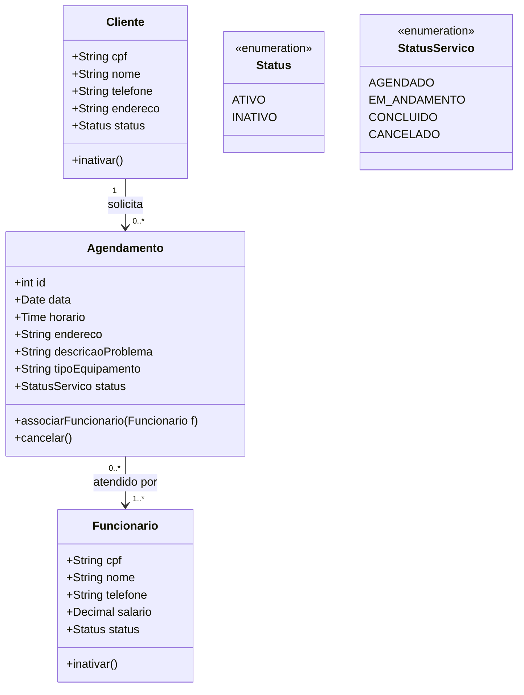
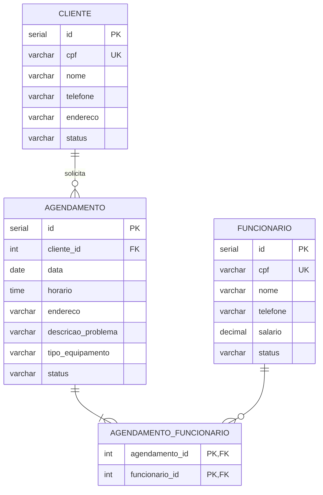

# Documento de Modelos

Neste documento temos o modelo Conceitual (UML) e o modelo de Dados (Entidade-Relacionamento) do Sistema de Gestão de Serviços da KG Refrigeração, além da descrição das entidades e do dicionário de dados. Os diagramas foram feitos com **Mermaid**.

> O escopo implementado nesta disciplina é a entidade **Cliente**. Funcionário e Agendamento estão modelados para a continuidade do projeto.

## Modelo Conceitual

### Diagrama de Classes usando Mermaid

### Descrição das Entidades

Descrição sucinta das entidades presentes no sistema.

| Entidade | Descrição |
|----------|-----------|
| Cliente | Pessoa atendida pela empresa. Tem as informações: cpf, nome, telefone, endereço e status. A exclusão é lógica, feita pelo método inativar(). |
| Funcionario | Técnico da empresa que executa os serviços. Tem as informações: cpf, nome, telefone, salário e status. |
| Agendamento | Serviço solicitado por um cliente. Tem as informações: data, horário, endereço, descrição do problema, tipo de equipamento e status. Pode ter um ou mais funcionários associados. |
| Status | Enumeração com a situação do cadastro: ATIVO ou INATIVO. |
| StatusServico | Enumeração com a situação do serviço: AGENDADO, EM_ANDAMENTO, CONCLUIDO ou CANCELADO. |

## Modelo de Dados (Entidade-Relacionamento)

### Dicionário de Dados

|   Tabela   | Cliente |
| ---------- | ------- |
| Descrição  | Armazena as informações dos clientes da KG Refrigeração. |
| Observação | A exclusão é lógica: o registro não é apagado, o status muda para INATIVO. |

|  Nome    | Descrição                          | Tipo de Dado | Tamanho | Restrições de Domínio |
| -------- | ---------------------------------- | ------------ | ------- | --------------------- |
| id       | identificador gerado pelo SGBD     | SERIAL       | ---     | PK / Identity |
| cpf      | CPF do cliente (apenas números)    | VARCHAR      | 11      | Unique / Not Null |
| nome     | nome completo do cliente           | VARCHAR      | 150     | Not Null |
| telefone | telefone de contato                | VARCHAR      | 15      | Not Null |
| endereco | endereço do cliente                | VARCHAR      | 250     | Not Null |
| status   | situação do cadastro               | VARCHAR      | 10      | Not Null / ATIVO, INATIVO / Default ATIVO |

|   Tabela   | Funcionario |
| ---------- | ----------- |
| Descrição  | Armazena as informações dos técnicos da empresa. |
| Observação | A exclusão é lógica, como em Cliente. |

|  Nome    | Descrição                          | Tipo de Dado | Tamanho | Restrições de Domínio |
| -------- | ---------------------------------- | ------------ | ------- | --------------------- |
| id       | identificador gerado pelo SGBD     | SERIAL       | ---     | PK / Identity |
| cpf      | CPF do funcionário (apenas números)| VARCHAR      | 11      | Unique / Not Null |
| nome     | nome completo                      | VARCHAR      | 150     | Not Null |
| telefone | telefone de contato                | VARCHAR      | 15      | Not Null |
| salario  | salário do funcionário             | DECIMAL      | 10,2    | >= 0 |
| status   | situação do cadastro               | VARCHAR      | 10      | Not Null / ATIVO, INATIVO / Default ATIVO |

|   Tabela   | Agendamento |
| ---------- | ----------- |
| Descrição  | Armazena os serviços agendados pelos clientes. |
| Observação | Não pode haver dois agendamentos no mesmo horário para o mesmo funcionário. |

|  Nome               | Descrição                        | Tipo de Dado | Tamanho | Restrições de Domínio |
| ------------------- | -------------------------------- | ------------ | ------- | --------------------- |
| id                  | identificador gerado pelo SGBD   | SERIAL       | ---     | PK / Identity |
| cliente_id          | cliente que solicitou o serviço  | INT          | ---     | FK / Not Null |
| data                | data do atendimento              | DATE         | ---     | Not Null |
| horario             | horário do atendimento           | TIME         | ---     | Not Null |
| endereco            | local do atendimento             | VARCHAR      | 250     | Not Null |
| descricao_problema  | descrição do problema relatado   | VARCHAR      | 500     | Not Null |
| tipo_equipamento    | tipo do equipamento              | VARCHAR      | 100     | Not Null |
| status              | situação do serviço              | VARCHAR      | 15      | Not Null / AGENDADO, EM_ANDAMENTO, CONCLUIDO, CANCELADO |

|   Tabela   | Agendamento_Funcionario |
| ---------- | ----------------------- |
| Descrição  | Associa os funcionários responsáveis a cada agendamento. |

|  Nome          | Descrição                | Tipo de Dado | Tamanho | Restrições de Domínio |
| -------------- | ------------------------ | ------------ | ------- | --------------------- |
| agendamento_id | agendamento associado    | INT          | ---     | PK / FK / Not Null |
| funcionario_id | funcionário associado    | INT          | ---     | PK / FK / Not Null |
