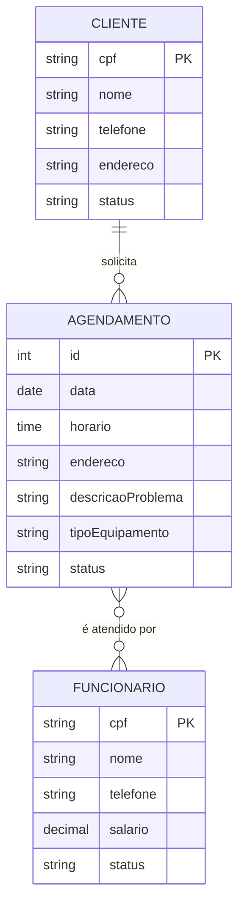

# Documento de Visão

Documento construído a partir do **Modelo BSI - Doc 001 - Documento de Visão**, com base na proposta *"Sistema de Informação para Gestão de Serviços da KG Refrigeração"*, desenvolvida nas disciplinas de Fundamentos de Sistemas de Informação e Organização, Sistemas e Métodos (OSM).

## Descrição do Projeto

A **KG Refrigeração Ltda** atua em Caicó/RN na instalação e manutenção de sistemas de climatização (ar-condicionado, ventilação e refrigeração) para clientes residenciais e comerciais. Hoje o controle de clientes e serviços é feito de forma manual, com anotações e WhatsApp, o que causa informações dispersas, conflitos de horários e falhas de comunicação.

O projeto propõe um sistema web para centralizar o gerenciamento de clientes, funcionários e agendamentos. **Nesta disciplina, o escopo implementado é o CRUD de Clientes (US01)**; as demais funcionalidades estão registradas no Product Backlog para continuidade futura.

## Equipe e Definição de Papéis

Membro     |     Papel   |   E-mail   |
---------  | ----------- | ---------- |
Profª Karliane Medeiros Ovidio Vale | Cliente (Professora) | karliane.vale@ufrn.br
Franciedson Lucas Linhares da Silva | Scrum Master | 
Juan Vyctor Silva Garcia de Oliveira | Product Owner | 
Leonardo Breno da Silva Santos | Developer | 
Nikcael Gidalte Lopes da Silva | Developer | 

### Matriz de Competências

Membro     |     Competências   |
---------  | ----------- |
Franciedson Lucas Linhares da Silva | _a preencher_ |
Juan Vyctor Silva Garcia de Oliveira | _a preencher_ |
Leonardo Breno da Silva Santos | _a preencher_ |
Nikcael Gidalte Lopes da Silva | _a preencher_ |

## Perfis dos Usuários

O sistema poderá ser utilizado pelos seguintes perfis/atores:

Perfil                                 | Descrição   |
---------                              | ----------- |
Gerente | Proprietário da empresa. Realiza os cadastros base (clientes e funcionários), gerencia agendamentos, associa técnicos aos serviços e pode realizar qualquer função.
Cliente | Pessoa atendida pela empresa. Pode se cadastrar, consultar e atualizar os próprios dados e solicitar agendamentos.
Funcionário (Técnico) | Colaborador que executa os serviços de instalação e manutenção. Consulta os próprios dados e os atendimentos associados a ele.

## Lista de Requisitos Funcionais

### Entidade Cliente - US01 - Manter Cliente ✅ *(escopo deste projeto)*
Um cliente tem CPF, nome, telefone, endereço e status (Ativo/Inativo). A exclusão é lógica: o cliente passa para o status "Inativo".

Requisito                     | Descrição   | Ator |
---------                     | ----------- | ---------- |
RF01.01 - Inserir Cliente      | Insere novo cliente informando: CPF, nome, telefone e endereço. Não permite CPF duplicado. | Gerente, Cliente |
RF01.02 - Listar Clientes      | Listagem dos clientes ativos utilizando filtros nos atributos: CPF e nome. | Gerente |
RF01.03 - Consultar Cliente    | Consulta um cliente informando o CPF (apenas números). | Gerente, Cliente |
RF01.04 - Atualizar Cliente    | Atualiza um cliente informando: nome, telefone e endereço. | Gerente, Cliente |
RF01.05 - Inativar Cliente     | Altera o status do cliente para "Inativo" após confirmação. | Gerente, Cliente |

---

### Entidade Funcionário - US02 - Manter Funcionário *(backlog futuro)*
Um funcionário tem CPF, nome, telefone, salário e status (Ativo/Inativo).

Requisito                     | Descrição   | Ator           |
---------                     | ----------- | ----------     |
RF02.01 - Inserir Funcionário   | Insere novo funcionário informando: CPF, nome, telefone e salário. | Gerente |
RF02.02 - Listar Funcionários   | Listagem de funcionários utilizando filtros nos atributos: CPF e nome. | Gerente |
RF02.03 - Atualizar Funcionário | Atualiza um funcionário informando: nome, telefone e salário. | Gerente |
RF02.04 - Inativar Funcionário  | Altera o status do funcionário para "Inativo" após confirmação com credenciais. | Gerente |

---

### Entidade Agendamento - US03 - Manter Agendamento *(backlog futuro)*
Um agendamento tem cliente, data, horário, endereço, descrição do problema, tipo de equipamento, status (Agendado, Em andamento, Concluído, Cancelado) e os funcionários responsáveis.

Requisito                     | Descrição   | Ator           |
---------                     | ----------- | ----------     |
RF03.01 - Inserir Agendamento   | Solicita um agendamento informando: descrição do problema, tipo de equipamento, data, horário e endereço. Verifica conflito de horário. | Cliente, Gerente |
RF03.02 - Listar Agendamentos   | Listagem de agendamentos utilizando filtros nos atributos: cliente, data e status. | Gerente |
RF03.03 - Atualizar Agendamento | Atualiza dados e status do agendamento. | Gerente |
RF03.04 - Associar Funcionários | Associa funcionários ao agendamento, verificando a disponibilidade de cada um. | Gerente |
RF03.05 - Cancelar Agendamento  | Altera o status para "Cancelado". Agendamentos concluídos não podem ser cancelados. | Gerente |

---

### Entidade Usuário - US04 - Autenticação *(backlog futuro)*

Requisito                     | Descrição   | Ator           |
---------                     | ----------- | ----------     |
RF04.01 - Login               | Realiza login informando usuário e senha. | Gerente, Cliente, Funcionário |
RF04.02 - Logout              | Encerra a sessão do usuário. | Gerente, Cliente, Funcionário |

---

### Modelo Conceitual

Abaixo apresentamos o modelo conceitual usando o **Mermaid**. Detalhes no [Documento de Modelos](doc-modelos.md).

#### Descrição das Entidades

Entidade | Descrição |
-------- | --------- |
Cliente | Pessoa física atendida pela empresa, identificada pelo CPF. |
Funcionário | Técnico que executa os serviços, identificado pelo CPF. |
Agendamento | Solicitação de serviço de um cliente em uma data e horário, atendida por um ou mais funcionários. |

## Lista de Requisitos Não-Funcionais

Requisito                                 | Descrição   |
---------                                 | ----------- |
RNF01 - Desempenho | O sistema deve responder às operações em menos de 2 segundos. |
RNF02 - Disponibilidade | O sistema deve estar disponível durante o horário de funcionamento da empresa. |
RNF03 - Segurança | O acesso às funções administrativas deve ocorrer mediante login e senha. |
RNF04 - Integridade dos dados | O sistema deve evitar dados duplicados (CPF único) e conflitos de agendamento. |
RNF05 - Usabilidade | A interface deve ser simples e intuitiva. |
RNF06 - Compatibilidade | O sistema deve ser acessível em computadores e dispositivos móveis, pelo navegador. |
RNF07 - Manutenibilidade | O sistema deve permitir futuras alterações sem comprometer seu funcionamento. |
RNF08 - Backup | O sistema deve possuir mecanismo de backup das informações. |

## Riscos

Tabela com o mapeamento dos riscos do projeto, as possíveis soluções e os responsáveis.

Data | Risco | Prioridade | Responsável | Status | Providência/Solução |
------ | ------ | ------ | ------ | ------ | ------ |
09/11/2026 | Prazo curto das Sprints (1 semana cada) | Alta | Scrum Master | Vigente | Manter o escopo no CRUD de Clientes e acompanhar o board diariamente |
09/11/2026 | Não aprendizado das tecnologias escolhidas por todos os membros | Alta | Todos | Vigente | Escolher uma stack já conhecida pela maioria e fazer pareamento |
09/11/2026 | Divisão de tarefas mal sucedida | Média | Scrum Master | Vigente | Distribuir issues na Sprint Planning e revisar na Daily |
09/11/2026 | Conflitos de código entre membros | Média | Todos | Vigente | Uma branch por issue e Pull Request com revisão |
09/11/2026 | Ausência de membros nas cerimônias em sala | Baixa | Scrum Master | Vigente | Registrar atas em `docs/atas` e atualizar a issue de Daily |

### Referências

- Proposta de Sistema de Informação para Gestão de Serviços da KG Refrigeração (UFRN/CERES, 2026).
- Modelo de Documento de Visão: https://github.com/tacianosilva/engenharia-software/blob/main/docs/doc-visao.md
